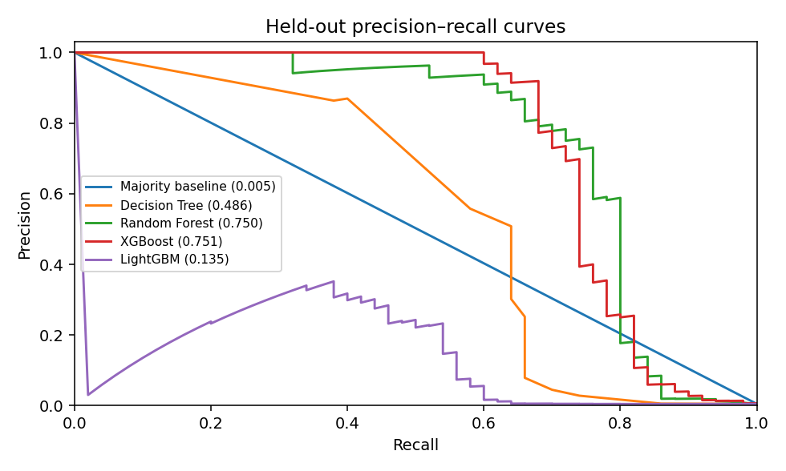
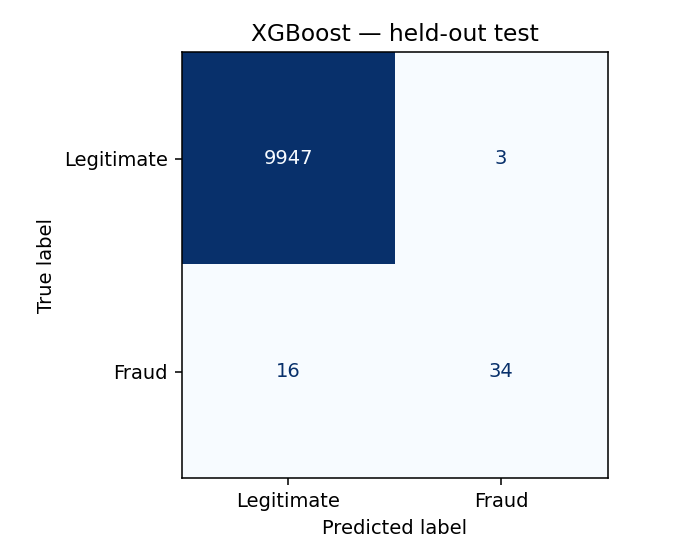

# Credit Card Fraud Detection | Project 19

**B.Tech Machine Learning — Ensemble Learning**

A reproducible classification project for prioritizing suspicious transactions under severe class imbalance. It compares a majority baseline, a decision tree, Random Forest, XGBoost and LightGBM, selects a model on validation average precision and uses a validation-tuned review threshold. A local browser prototype and a CSV predictor are included.

> **Dataset disclosure:** All bundled results, charts and trained model are based on 50,000 **simulated** transactions, not actual cardholder records. The original ULB/Worldline public benchmark could not be downloaded in the build environment. The project also supports that dataset using a separate training run; real-data results are not claimed. Ask your faculty whether the simulated submission is acceptable or run the real benchmark before submission.

## Results (held-out simulated test set)

| Model | Precision | Recall | F1 | Average precision | ROC-AUC |
|---|---:|---:|---:|---:|---:|
| Majority baseline | 0.000 | 0.000 | 0.000 | 0.005 | 0.500 |
| Decision Tree | 0.508 | 0.640 | 0.566 | 0.486 | 0.819 |
| Random Forest | 0.846 | 0.660 | 0.742 | 0.750 | 0.944 |
| **XGBoost (selected)** | **0.919** | **0.680** | **0.782** | **0.751** | **0.956** |
| LightGBM | 0.318 | 0.400 | 0.354 | 0.135 | 0.692 |

XGBoost achieved 99.81% accuracy, but the majority baseline already achieved 99.50% while detecting no fraud. On 10,000 test records, XGBoost flagged 34 of 50 simulated frauds and 3 legitimate records, missing 16 frauds. Scores are not calibrated probabilities.




## Quick start (Python 3.11)

Extract the ZIP, open a terminal in the folder containing this README, then:

```bash
python -m venv .venv
# Windows: .venv\Scripts\activate
# macOS/Linux: source .venv/bin/activate
python -m pip install -r requirements.txt
python app.py
```

Open `http://127.0.0.1:8000` in a browser. Select a held-out example, edit anonymized numeric features if desired, and press **Evaluate transaction**. Stop with Ctrl+C. No dataset download or model training is needed for the bundled demo. Do not enter real payment details. Only load model files you trust.

### Notebook and reproducibility

```bash
python -m pip install -r requirements-notebook.txt
jupyter lab Project_19.ipynb
```

The executed notebook explains the workflow, retrains the models and demonstrates predictions. To reproduce from the terminal:

```bash
python generate_data.py
python train.py
python predict.py
python -m unittest discover -s tests -v
```

To predict a custom CSV containing all 30 features:

```bash
python predict.py --input data/my_transactions.csv --output predictions.csv
```

### Use the real public benchmark (optional for demo; recommended for real-world validation)

Download the anonymized CSV from [Kaggle / ULB](https://www.kaggle.com/datasets/mlg-ulb/creditcardfraud), place it at `data/creditcard.csv`, or try `python download_data.py` (requires internet). The original dataset contains 284,807 records and 492 frauds before cleaning. The source is not redistributed here.

```bash
python train.py --mode real --data data/creditcard.csv --output artifacts_real
python app.py --artifacts artifacts_real
python predict.py --model artifacts_real/model.joblib --input artifacts_real/example_transactions.csv
```

Real-mode outputs are isolated from the bundled simulation results. Update the report/presentation with real-mode figures if you use real results in your assessment. Random stratified splitting is for comparison, not a future-time deployment test. Real-data training time depends on hardware.

## Methodology

1. Validate schema, finite numeric values and binary target. Remove exact duplicate rows and conflicting feature groups before splitting.
2. Stratified 60/20/20 train/validation/test split, seed 42. Keep natural class prevalence in every split.
3. Train weighted tree and ensemble models; no test-set resampling or synthetic minority oversampling. Scaling is unnecessary for these tree models.
4. Select the non-baseline model by validation average precision. Tune each threshold to maximize validation F1. The baseline always predicts legitimate.
5. Freeze model and threshold; evaluate on untouched held-out test data. Compare precision, recall, F1, AP, ROC-AUC and confusion matrices.
6. Export the selected model and review errors. Use a local interface for human-review flags.

## Project files

| Path | Purpose |
|---|---|
| `Project_19.ipynb` | Executed end-to-end notebook |
| `generate_data.py`, `download_data.py` | Simulated data generator and real benchmark downloader |
| `train.py`, `predict.py`, `app.py` | Training, CSV prediction and browser prototype |
| `data/` | Compressed simulated dataset and data documentation |
| `artifacts/` | Trained model, metrics, plots, example inputs and test errors |
| `docs/` | Project report (PDF), presentation (PPTX), proposal and viva notes |
| `tests/` | Local automated checks |

## Ethics and limitations

Educational decision support only, not a production payment system. False positives may inconvenience customers and false negatives may permit loss. Do not store raw card details or expose the local server to the internet. The simulated features have artificial class patterns; they do not establish real-world performance or fairness. The real benchmark is old, anonymized, from a limited geography and short time span. No demographic attributes are available to evaluate group fairness; absence of data does not establish fairness. Real deployment requires chronological validation, drift monitoring, calibration, operational costs, security review and human oversight.

## College submission and demonstration

Submit this complete project folder with the report, presentation, source code, notebook, dataset and saved results. Start with the PDF report in `docs/`, use the PowerPoint for the presentation, and demonstrate the application by following the Quick start section above. The viva notes provide revision questions and answers. Add your student/team details if your college requires them, and obtain faculty approval for the simulated dataset or run the optional real-data workflow before submission. No online repository is needed to run the project.

## References

- ULB / Worldline, [Credit Card Fraud Detection dataset](https://www.kaggle.com/datasets/mlg-ulb/creditcardfraud).
- [TensorFlow public CSV mirror](https://storage.googleapis.com/download.tensorflow.org/data/creditcard.csv).
- [Scikit-learn model evaluation](https://scikit-learn.org/stable/modules/model_evaluation.html).
- [XGBoost documentation](https://xgboost.readthedocs.io/) and [LightGBM documentation](https://lightgbm.readthedocs.io/).
- Course project bank, Project 19 and minimum submission requirements.
